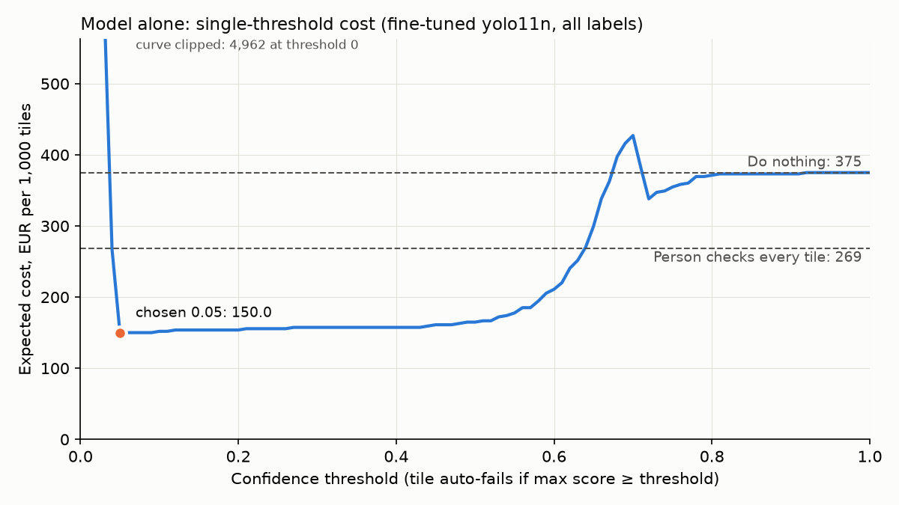

# Assignment 2 Report

- **Name**: Moritz Hanbuch
- **Student ID**: 19140
- **Email**: mgobbels.ieu2022@student.ie.edu
- **Group**: BBADBA 5A

## Business problem, and the cost of being wrong

My model supports automated optical inspection (AOI) on a printed circuit board (PCB) fabrication line. It sits after etching and before any components are mounted. A camera needs to photograph every board, and for each quarter of a board (tile) the model decides whether it passes, goes to a verifier at a review station, or fails automatically. I decided to use tiles instead of whole boards for the following two reasons. First of all, because the verifier checks regions and hence the review cost is paid per region. Second of all, it allows me to measure false alarms at tile level. This is important, because they are not measurable at board level since every board in the dataset has at least one defect. The positive class of the model is "the tile contains at least one defect". This seems simplified but is the best choice since the action is the same for every defect type.

The model has two different types of errors, which have very different "costs of being wrong":

1. Missed defect (false negative), which is only found at assembly, after components have been mounted on a faulty board. This means wasted components plus rework or scrap. In my business case I estimate this at €50.
2. False alarm (false positive), which costs €0.25 if the tile goes to review (20 seconds of the verifier's time) and €5 if it is auto-failed, because a good board is scrapped.

A miss is therefore 200 times worse than a review and 10 times worse than scrapping a good board. The 10x between a scrapped board and a miss matches the Rule of 10, which says that the cost of a defect increases by about a factor of ten with each further production stage ([VSE](https://www.vse.com/ensuring-high-quality-pcbs-with-extensive-testing/); see also [Salitronic](https://salitronic.com/kb/design-for-test/)).

This asymmetry drives the rest of the design. A tile should only pass if the model is almost certain it is clean, it should only be auto-failed if the model is very confident, and everything in between goes to a person. The metric I optimise is therefore the expected cost per 1,000 tiles at the production base rate, not accuracy or mAP.

## Dataset

Roboflow Universe, used as is: workspace `srtimagedefectdetection-wuadb`, project `pcb-defect-detection-hdqc8`, version 3 ([link](https://universe.roboflow.com/srtimagedefectdetection-wuadb/pcb-defect-detection-hdqc8/dataset/3)).

One image is a 640x640 tile, a quarter of a top-down photo of a bare board. The six classes are missing_hole, mouse_bite, open_circuit, short, spur and spurious_copper (Roboflow only names them 0 to 5, so I mapped them using the source filenames). The dataset serves the decision because it shows bare boards with typical etching and drilling defects, which is exactly what inspection at this stage has to catch. I chose version 3 over version 1, because version 1 contains only whole boards, and 100% of them have defects. With version 1 I would not have been able to measure false alarms, which make up half of my cost analysis. Finally, the filenames of my dataset match the PKU PCB dataset, whose defects are probably synthetic, so mine might be too.

## What the dataset's composition implies

| Split | Photos | Tiles | Clean tiles | missing_hole | mouse_bite | open_circuit | short | spur | spurious_copper |
|---|---|---|---|---|---|---|---|---|---|
| Train (augmented ~3x) | 417 | 4,912 | 1,559 (32%) | 207 | 1,091 | 1,082 | 1,061 | 1,109 | 1,135 |
| Validation | 117 | 468 | 149 (32%) | 23 | 93 | 110 | 105 | 102 | 114 |
| Test | 72 | 288 | 85 (30%) | 15 | 67 | 55 | 68 | 72 | 57 |

In general the defects are quite small: the median defect box is about 7% of the tile side (around 44 px), and tiling sometimes cuts a defect at a tile edge, leaving thin slivers (13 test boxes) that count as misses even though they are almost invisible. Some of the defect types are also less trustworthy than others. For example, missing_hole has only 15 test boxes from 4 photos and far fewer training examples than the other classes (207 against about 1,100), so its per-class result can vary a lot. Moreover, the false alarm rate depends on only 85 clean tiles, where a single extra false alarm already moves it by more than one percentage point.

On top of that, the test split does not resemble real production. 70% of test tiles are defective, while I assume around 0.75% in production (explained below), so all costs use the assumed rate. Finally, the same 10 board designs appear in every split. No photo is shared, which is fine for a line producing these designs, but all 85 clean test tiles have very similar versions in the training set, so the false alarm rate is effectively measured on images the model has already seen. As a result, I cannot conclude how the model performs on real defects, on new board designs, or on real clean boards.

## Finetuning and baselines

I used detection because the defects are small, and a box tells the verifier exactly where to look. I chose yolo11n, the smallest model, because it trains fast, especially locally on my laptop (2.13 h of training). It was trained at 640 px for up to 100 epochs with early stopping (patience 20) and otherwise default Ultralytics settings (batch 16), and Ultralytics picked epoch 51 by validation mAP50-95.

| Model (same test split) | mAP50 | mAP50-95 |
|---|---|---|
| Finetuned yolo11n | 0.812 | 0.383 |
| Finetuned yolo11n, slivers ignored | 0.862 | 0.412 |
| Finetuned yolo11n, class-agnostic | 0.847 | 0.382 |
| COCO yolo11n zero-shot, class-agnostic | 0.000 | 0.000 |
| Predict nothing | 0.000 | 0.000 |

The two baselines score zero and perform worst. This is expected, because predicting nothing will not find any defects, and the COCO model was trained on everyday objects, so none of its boxes overlapped a defect closely enough to count, even though it was scored class-agnostically. Finetuning the yolo11n raised mAP50 to 0.812, so the gap to both baselines is as large as I expected. While this is a substantial improvement, the performance is still held back by the small defects and the slivers, which count as misses. To check this, I also evaluated the same model with the slivers ignored, which increased mAP50 to 0.86. Furthermore, if I score it class-agnostically like COCO, it reaches 0.85, only slightly higher than 0.81, which shows that the model rarely confuses one defect type with another. The low mAP50-95 is typical for small boxes, where a shift of a few pixels already fails the strict IoU thresholds. However, for my decision only the tile matters, and at threshold 0.05 the model flags 91% of defective tiles.

## Per-class evaluation and failure modes

| Class | Test boxes | AP50 | Precision* | Recall* |
|---|---|---|---|---|
| short | 68 | 0.891 | 0.929 | 0.868 |
| open_circuit | 55 | 0.886 | 0.978 | 0.873 |
| mouse_bite | 67 | 0.842 | 0.943 | 0.776 |
| spur | 72 | 0.799 | 0.963 | 0.718 |
| spurious_copper | 57 | 0.770 | 0.811 | 0.828 |
| missing_hole | 15 | 0.685 | 0.842 | 0.733 |

*At the confidence that maximises mean F1, not at my operating threshold.

| Predicted ↓ / True → (conf 0.25) | missing_hole | mouse_bite | open_circuit | short | spur | spurious_copper | no defect (false box) |
|---|---|---|---|---|---|---|---|
| missing_hole | 11 | 0 | 0 | 0 | 0 | 0 | 2 |
| mouse_bite | 0 | 53 | 0 | 0 | 0 | 0 | 6 |
| open_circuit | 0 | 1 | 48 | 0 | 0 | 0 | 0 |
| short | 0 | 0 | 0 | 61 | 0 | 0 | 8 |
| spur | 0 | 0 | 0 | 0 | 54 | 0 | 5 |
| spurious_copper | 0 | 0 | 0 | 0 | 6 | 48 | 5 |
| no box (missed) | 4 | 13 | 7 | 7 | 12 | 9 | – |

The headline mAP50 is carried by short and open_circuit, which both reach an AP50 of about 0.89. However, it is dragged down by spur, which has the lowest recall (0.72) and spurious_copper, which has the lowest precision (0.81). missing_hole looks like the weakest class, but as mentioned earlier this is mainly caused by only 15 test boxes and in this case also by the tiling slivers. Without the slivers its AP50 increases to 0.85.

The confusion matrix shows that the model mostly breaks by missing defects rather than confusing them (clear diagonal). In fact, 52 defects get no box at all (most often mouse bites and spurs) while only 7 are assigned the wrong type (confused). The model mainly confused "spur" and "spurious_copper". This also makes sense, since both are excess copper and look very similar in reality. However, for my model this matters less and does not directly affect my decision, because any defect counts as positive, while the misses are what actually cost the system the money.

Since my decision is made per tile, I also looked at where the model fails at tile level. Each tile gets a score, which is the highest confidence of any box the model draws on it. At my lower threshold of 0.05 (explained in the cost section), 18 of the 203 defective tiles score below it and would pass unnoticed, while only 2 of the 85 clean tiles score above it, both at 0.71. When I looked closer at these 2 false alarms, I found that they come from the same photo, and when I compared them with other photos of the same board design, they actually show a small copper spur that the other photos lack. Therefore, I think that these were most likely real defects that were never labelled, which means my model was actually right and the dataset was wrong in this case. It is important to consider this, since these two tiles are what sets my upper threshold.

## Cost matrix and operating point

| Decision | Defective tile | Clean tile |
|---|---|---|
| Pass | €50 (missed defect) | €0 |
| Review | €0.25 + 5% x €50 = €2.75 | €0.25 |
| Auto-fail | €0 | €5 (good board scrapped) |

- €50 follows from the Rule of 10 between fabrication and assembly.
- €5 is a simple single-layer 10x10 cm board at $0.10-0.50 per in² ([ALLPCB](https://www.allpcb.com/allelectrohub/decoding-pcb-manufacturing-costs-a-comprehensive-guide-for-2025)).
- €0.25 is 20 seconds per check, which is my own assumption, at €45/h, the German labour cost in 2025 ([Eurostat, dataset lc_lci_lev](https://ec.europa.eu/eurostat/databrowser/view/lc_lci_lev/default/table)), which I chose deliberately high because it works against my review band. And for this I assume the verifier catches 95% of defects.
- For the base rate I assume 3% of boards are defective. Most manufacturers produce yields below 95%, and above 98% is achievable ([I-Connect007](https://iconnect007.com/article/132741/connect-the-dots-cautionyield-ahead/132744/pcb)), so 3% assumes a well-run line. I also assume one defective tile per defective board. This gives a base rate of 0.75% tiles as defective.

Sweeping a single threshold (model decides alone & no human reviewer) gives a minimum of €150.02 per 1,000 tiles at 0.05, and the cost comes mostly from scrapped good boards. In order to counter this, I implemented two thresholds with a review band in between (pass below 0.05, review between 0.05 and 0.72, auto-fail at 0.72 and above; described below), which decreased the cost to €55.85 per 1,000 tiles.

I tested my assumptions using a sensitivity analysis to search for the values at which each one changes the chosen band:

| Assumption | Main case | Band holds while |
|---|---|---|
| Missed defect cost | €50 | €1.27 to €222 |
| Scrapped good board | €5 | above €0.97 |
| Verifier accuracy | 95% | above 64% |
| Review cost per tile | €0.25 | €0.06 to €3.45 |
| Board defect rate | 3% | 0.06% to 13% |

The missed defect cost and the board defect rate are about equally close to their limits (both about four times my estimate), but I consider the cost of a missed defect the assumption that would most change my answer, because it is the hardest to estimate, since a defect that reaches a customer can cost far more than one caught at assembly. If we compare it to a higher cost, e.g. €500, a person would have to check 97% of all tiles, which changes the whole design. Otherwise, the band is quite robust to errors and the other assumptions would either have to be wrong by a large margin or only shift the lower threshold slightly.

## What a person still has to check

My thresholds are: pass below 0.05, review between 0.05 and 0.72, and auto-fail at 0.72 and above. Both come from sweeping all pairs in steps of 0.01. As a result, this sends 2.94% of tiles to a person, which are about 57 of 1,920 tiles a day (assuming 30 boards/h over 16 h). And at 20 seconds each, that is about 19 minutes a day (0.02 of a person per shift). This is realistic, since existing line operators can do it alongside other work, as long as they are near the station each shift.

| Design (per 1,000 tiles) | Cost | Verifier hours/day |
|---|---|---|
| Review band (0.05 / 0.72) | €55.85 | 0.31 |
| Model decides alone (0.05) | €150.02 | 0 |
| Person checks every tile | €268.75 | 10.67 |
| Do nothing | €375.00 | 0 |

The band is €94 cheaper than the next best option because the model clears the clean majority, and only the uncertain 3% reach a person. Doing nothing lets every defect through and costs the most. Checking everything wastes almost 11 hours a day on clean tiles, and the model alone scraps good boards without any safeguard. If we roll this up to whole boards (a board fails if any tile fails), all 72 defective test boards were flagged. But this number should be treated with caution, since I was not able to measure the false alarm rate at board-level because there are no clean test boards.

A bootstrap over the test tiles (1,000 resamples) shows that the lower threshold is stable at 0.04-0.05, while the upper threshold is fragile because it depends on the two clean tiles at 0.71. Since I chose the thresholds on the test set, I also checked them on the validation set, and the upper threshold does not transfer: chosen on validation it would be 0.67, which costs €161.70 per 1,000 tiles on test because it auto-fails the two tiles at 0.71. However, these are the two mislabelled tiles mentioned earlier, and when I compared the three high-scoring clean tiles in validation with other photos of the same design in the same way, they also look like unlabelled defects, so the upper threshold is mostly set by labelling errors. If my assumption is correct and the two test tiles are in fact defective, then the model alone would look cheapest at about €33. But the clean tiles are near-copies of training images, so I cannot yet trust the false alarm rate on real boards.

Therefore, my decision would be to ship my model as a supervised pilot with the upper threshold initially set to 1.0, so nothing is auto-failed. This costs about €2 more per 1,000 tiles than my band (€57.89 against €55.85), and about €19 more than the model alone if the two test tiles are real defects. Both my band and this design hold up on both splits (€50-56 and €52-58), but only an upper threshold of 1.0 can never scrap a good board, whatever the real false alarm rate turns out to be. Once real clean boards from the pilot confirm the false alarm rate, I would switch auto-fail on.

My dashboard shows the cost, review load and results live, with sliders for both thresholds.

## Limitations & next steps

- The defects are probably synthetic defects and the data only includes 10 board designs. With more time, I would test the model on real production boards and include more different designs.
- The false alarm rate is measured on clean tiles that are very similar versions to the training images. During the pilot, I would collect real clean boards and recalibrate the upper threshold on them.
- I picked the thresholds on the test set, so the €55.85 is optimistic. A check on the validation set showed that the upper threshold does not transfer between splits, so with more time I would choose the thresholds on validation and recalibrate the upper threshold on real clean boards.
- My costs and base rate are partly estimates. With access to a real line, I would replace them with its actual yield and the real cost of a missed defect.
- The small model misses many small mouse bites and spurs at 640 px. I would try yolo11s and a larger image size such as 1024, so these defects get more pixels.
- Every missed defect currently costs the same, although some defects can be repaired, and shorts and opens are usually caught later by electrical testing anyway. I would give each defect type its own miss cost and check whether the band changes.

## Generative AI use disclosure

- Coding: I used Claude Code with Claude Opus 5.5 for the boilerplate and common operations: downloading the Roboflow PCB dataset, wiring up the YOLO training call, plotting, and the Gradio dashboard (app.py). Its sanity checks also helped me spot the likely mislabelled tiles, which I then checked myself. The code only implements decisions I made, and I reviewed all of it afterwards.
- Research: I used AI to find real-world cost figures and sources for PCB defects and inspection. I chose which of those numbers went into my cost model.
- Decisions: These are mine. I framed the problem as tile-level inspection with a human verifier station, where a positive means a tile has any defect, and kept the board-level rollup as a secondary view. I set the cost of a missed defect and of a false alarm, placed the thresholds based on those costs, decided how many tiles go to the human verifier, and made the call on whether the model is good enough to ship. I talked through trade-offs on some of these with Claude in voice mode, but every decision was mine.
- Report: The ideas, findings and conclusions are my own. At the end, I used AI for formatting and polishing, and I reviewed everything again afterwards.
